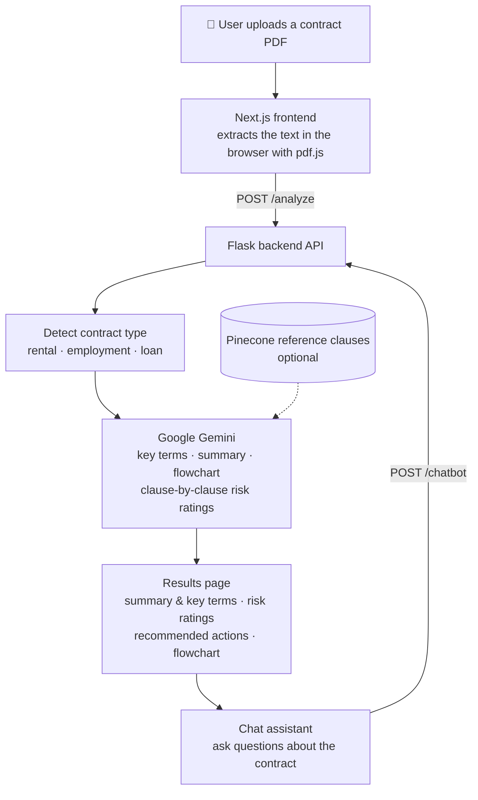

# LawLight: Legal Analyzer App

**LawLight** is your personal legal buddy. Upload a contract and get a plain-English explanation, the risky clauses flagged, and answers to your questions — in under a minute.

---

## 🚀 What it does

Imagine opening a 20-page rental agreement and actually understanding it in 2 minutes. That's what LawLight does:

- **Upload a contract** (rental, employment or loan, as a PDF) — the type is detected automatically.
- **Plain-English summary** of what the agreement means, plus the key terms (parties, rent/salary/loan amount, deposit, duration, notice period…).
- **Clause-by-clause risk ratings** — each clause is marked 🔴 Red, 🟡 Yellow or 🟢 Green with an explanation and what to do about it, tuned for Indian (Bengaluru/Karnataka) practice.
- **Recommended actions** and an **overall risk level** for the document.
- **Visual flowchart** of how the agreement plays out.
- **Chat assistant** — ask things like *"Can I get my deposit back?"* and get short, practical answers based on your contract.
- **Employment contracts:** estimated monthly in-hand salary (PF, professional tax, TDS).

---

## 🔄 User Flow



---

## 🏗️ Tech Stack

- **Frontend:** Next.js 15 (React, Tailwind CSS); PDF text is extracted in the browser with pdf.js
- **Backend API:** Python Flask
- **AI:** Google Gemini via the Gemini API (`google-genai`)
- **Optional:** Pinecone vector DB of reference clauses (for grounded risk analysis) and Tavily web search (live loan-rate comparison)

---

## 🖥️ Getting Started

### Prerequisites

- [Node.js](https://nodejs.org) 18+ and npm
- [Python](https://www.python.org) 3.11+
- A free **Gemini API key** from [Google AI Studio](https://aistudio.google.com/apikey) — just a Google account, no credit card or Google Cloud setup needed

### 1. Backend (Flask API)

```bash
cd backend
python -m venv .venv

# Windows
.venv\Scripts\activate
# macOS / Linux
source .venv/bin/activate

pip install -r requirements.txt
```

Create your config file and add your key:

```bash
# Windows
copy .env.example .env
# macOS / Linux
cp .env.example .env
```

Then open `backend/.env` and paste your key after `GOOGLE_API_KEY=`.

Start the server:

```bash
python main.py
```

The API runs at `http://localhost:8080`. Check it with `http://localhost:8080/health` — `gemini_key_set` should be `true`.

### 2. Frontend (Next.js)

In a second terminal:

```bash
cd frontend
npm install
npm run dev
```

Open **http://localhost:3000**, click **Get Started**, and upload a contract PDF.

The frontend talks to `http://localhost:8080` by default. To point it at a different backend, create `frontend/.env.local` with:

```
NEXT_PUBLIC_API_URL=https://your-backend-url
```

---

## ⚙️ Configuration (`backend/.env`)

| Variable | Required | Description |
|---|---|---|
| `GOOGLE_API_KEY` | ✅ | Gemini API key from [AI Studio](https://aistudio.google.com/apikey) |
| `GEMINI_MODEL` | | Model to use (default `gemini-3.1-flash-lite`). If it's busy or retired, the backend automatically falls back to other models. |
| `GEMINI_FALLBACK_MODELS` | | Comma-separated fallback models |
| `GEMINI_TIMEOUT_SECONDS` | | Per-request timeout (default `30`) |
| `CLAUSE_WORKERS` | | Clauses analysed in parallel (default `4`) |
| `PINECONE_API_KEY` | | Enables the reference-clause knowledge base (also run `pip install -r requirements-optional.txt`; indexes are built with `vectorize-rental-docs.ipynb`) |
| `TAVILY_API_KEY` | | Enables live bank-rate search for the `/loan_comparison` endpoint |

Never commit `.env` files — they're already in `.gitignore`.

---

## 🔌 API

| Endpoint | Method | Body | Returns |
|---|---|---|---|
| `/health` | GET | – | Server status and which services are configured |
| `/analyze` | POST | `{ "text": "<contract text>" }` | `contract_type`, `key_entities`, `summary`, `detailed_analysis`, `flowchart`, `salary_analysis` (employment) |
| `/chatbot` | POST | `{ "summary", "detailedAnalysis", "question" }` | `{ "answer" }` |
| `/loan_comparison` | POST | `{ "summary" }` | `{ "comparison" }` |

---

## ☁️ Deployment

The backend includes a `Dockerfile` (gunicorn) suitable for Google Cloud Run or any container host — set `GOOGLE_API_KEY` as an environment variable / secret. The frontend can be deployed to Vercel; set `NEXT_PUBLIC_API_URL` to your backend's URL.

---

## ⚠️ Limitations

- Only **text-based PDFs** are supported. Scanned documents (images) have no extractable text, so they can't be analysed yet.
- On the free Gemini tier, analysis takes roughly 10–90 seconds depending on Google's load, and there's a daily request limit (each document uses about 4 calls plus one per clause).
- LawLight gives general information, not legal advice. Consult a lawyer for important decisions.
